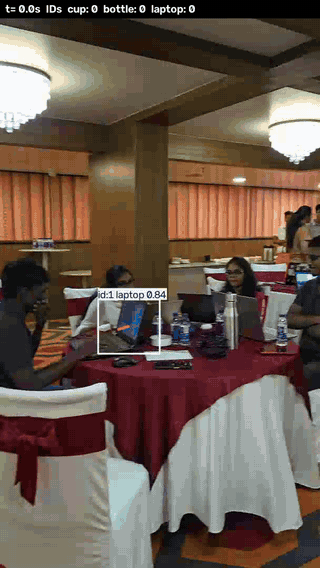
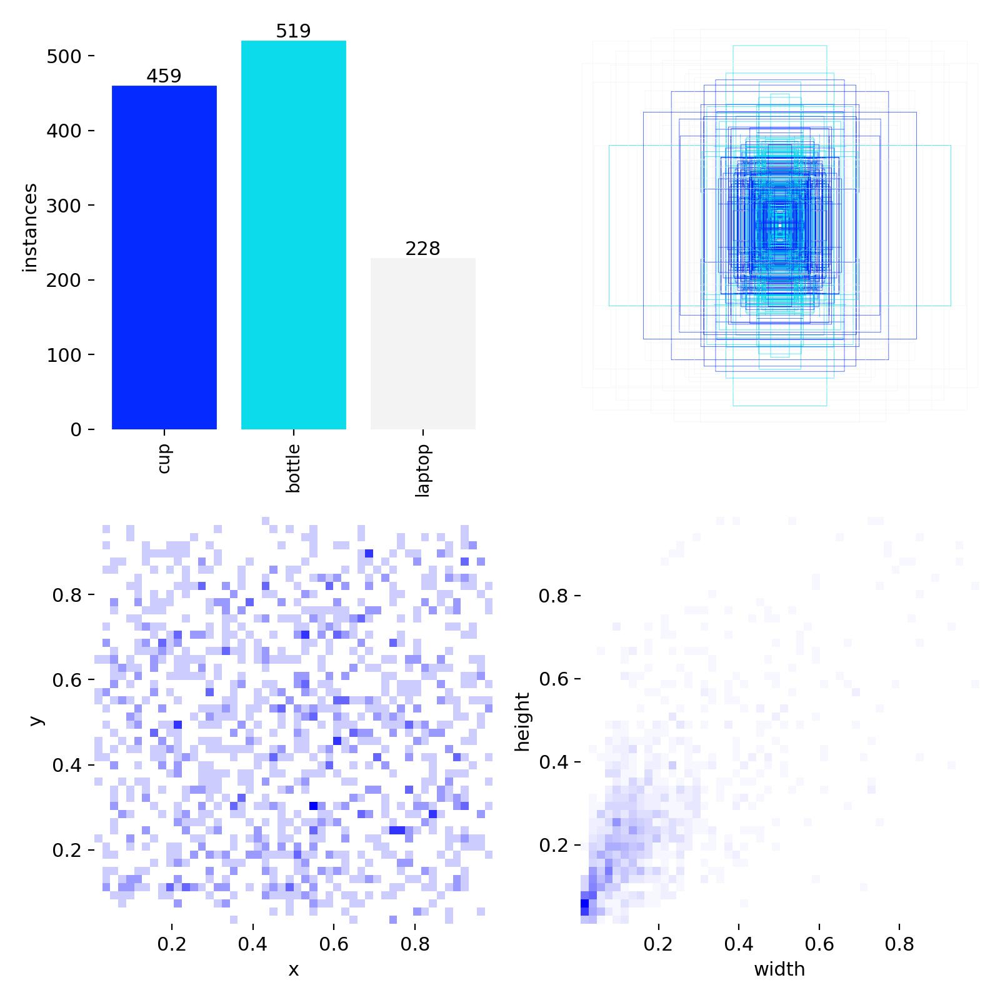
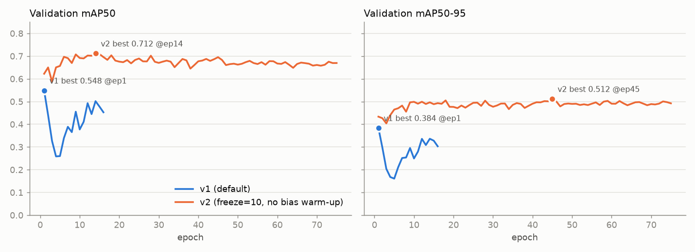
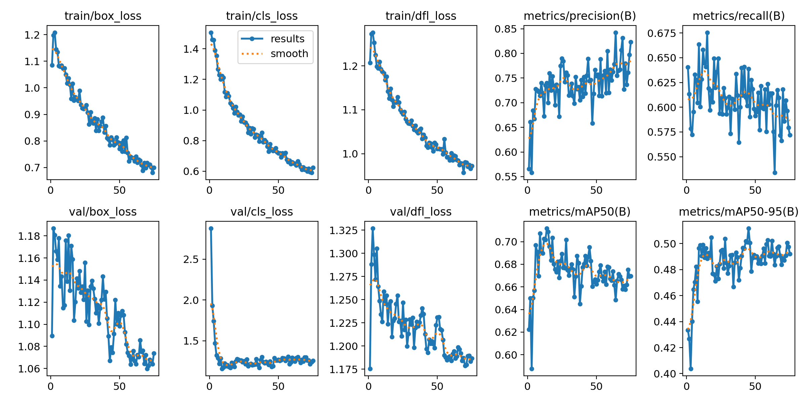
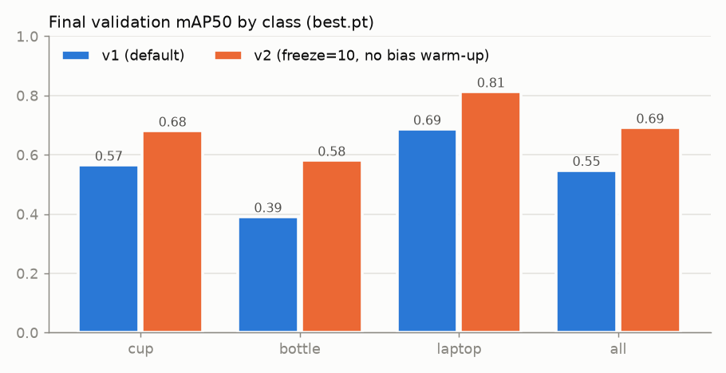
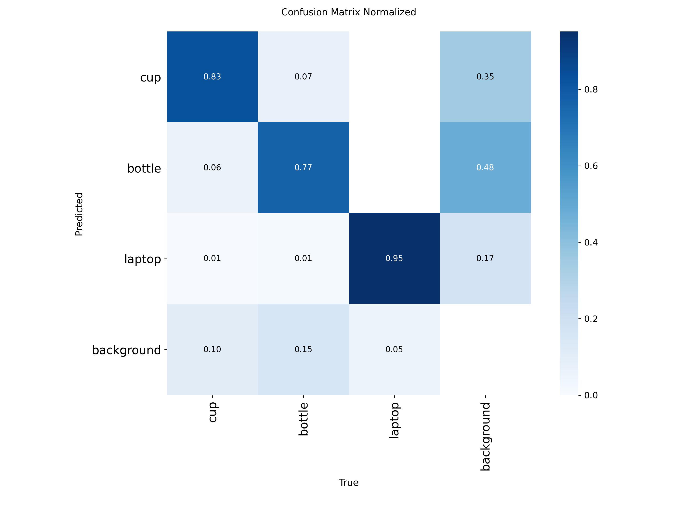
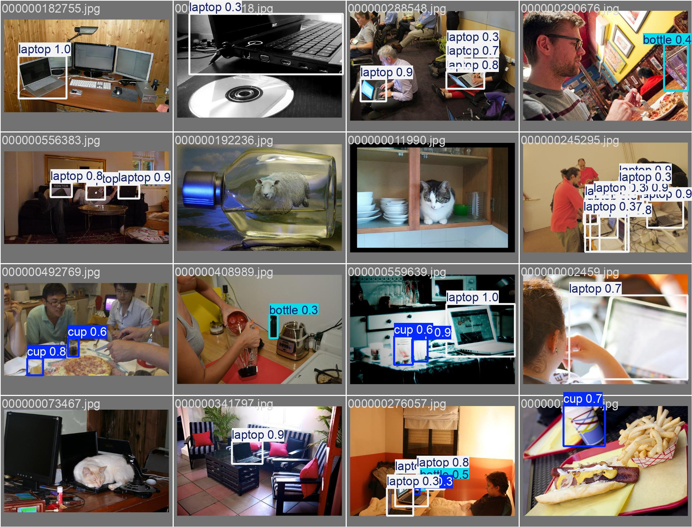
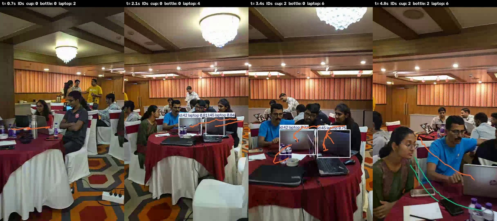
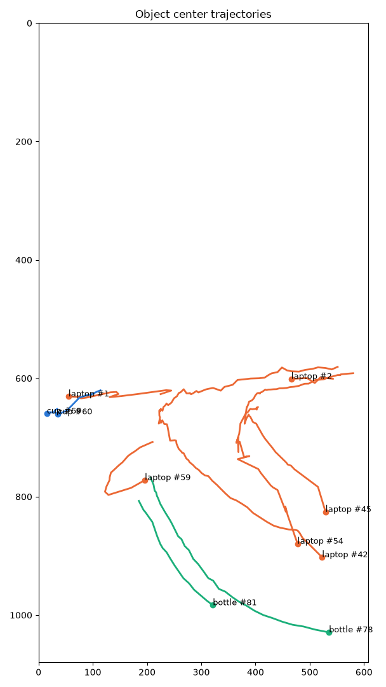
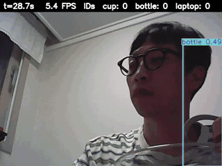

# YOLOv8 3개 부류(컵 · 병 · 노트북) 객체 감지 및 추적

인공지능 수업 YOLO 실습 과제 결과보고서

- **GitHub:** https://github.com/deokpyorobo/yolo-3class-tracking
- **부류:** `cup`, `bottle`, `laptop`
- **모델:** YOLOv8n (COCO 사전학습 가중치에서 미세조정)
- **결과 요약:** 검증 mAP50 **0.692**, mAP50-95 **0.513** (1차 0.548 → 2차 0.692)
- **추적:** ByteTrack, 5초 영상, 궤적(trajectory) 저장, 부류별 ID 카운팅
- **추론 장치:** 노트북 CPU / Intel Arc GPU / **NPU(Intel AI Boost)**, OpenVINO 사용



결과 동영상: [results/tracking_result.mp4](results/tracking_result.mp4) (5.0초, 608×1080, 29fps)

---

## 1. 저장소 구성

| 경로 | 내용 |
|---|---|
| `models/best.pt` | **최종 학습 모델** (2차 실험, 6.5MB) |
| `models/best_v1.pt` | 1차 실험 모델 (비교용) |
| `models/best_openvino_model/` | NPU/Intel GPU 추론용 OpenVINO 변환 모델 |
| `results/tracking_result.mp4` · `.gif` | **5초 감지·추적 결과 동영상** |
| `results/trajectories.csv` · `.png` | 객체 ID 별 중심점 궤적 (프레임마다 좌표 저장) |
| `results/npu/` | 같은 영상을 NPU 로 추론·추적한 결과 |
| `results/device_benchmark.json` | CPU / GPU / NPU 추론 속도 비교 |
| `results/jetson/` | Jetson Nano TensorRT 추적 결과, 속도 측정(`benchmark.json`), 웹캠 실시간 추적 영상 |
| `results/training/` | 학습 곡선, confusion matrix, PR 곡선, 실험별 지표 |
| `scripts/prepare_dataset.py` | 데이터 수집 + YOLO 형식 변환 |
| `scripts/train.py` | 로컬 학습 스크립트 |
| `colab/train_colab.ipynb` | Google Colab(T4 GPU) 학습 노트북 (실제 학습에 사용) |
| `scripts/track.py` | 감지 + 추적 + 궤적 저장 + 카운팅 |
| `scripts/benchmark_devices.py` | OpenVINO 변환 및 CPU/GPU/NPU 속도 비교 |
| `input/source_clip_3s-8s.mp4` | 추적에 사용한 원본 5초 구간 |

## 2. 데이터 수집

직접 촬영해서 라벨링하는 대신, 공개 데이터셋 **COCO 2017 train** 에서 세 부류의 이미지와 라벨을 골라
YOLO 형식으로 변환했습니다 ([scripts/prepare_dataset.py](scripts/prepare_dataset.py)).

1. COCO annotation(`instances_train2017.json`)에서 `cup`, `bottle`, `laptop` 박스만 추출 (`iscrowd` 제외)
2. 부류마다 해당 객체가 이미지 면적의 2% 이상으로 **충분히 크게 보이는** 이미지를 무작위로 200장씩 선택 → **총 600장**
3. 선택한 이미지 안의 세 부류 객체는 **모두** 라벨링 (예: 컵 사진 안의 병도 bottle 로 라벨)
4. COCO `[x, y, w, h]`(픽셀) → YOLO `class cx cy w h`(0~1 정규화) 변환
5. 부류별 비율을 유지하며 **train 480장 / val 120장 (8:2)** 분할

| | 이미지 | cup | bottle | laptop |
|---|---|---|---|---|
| train | 480 | 459 | 519 | 228 |
| val | 120 | 144 | 160 | 62 |



## 3. 학습 과정

### 3-1. 학습 환경

| 시도 | 장치 | 결과 |
|---|---|---|
| 로컬 노트북 (Galaxy Book5 Pro) | CPU (Core Ultra 7 256V) | epoch 당 약 85초, 발열·팬 소음 때문에 4 epoch 에서 중단 |
| **Google Colab** | **NVIDIA T4 GPU** | epoch 당 약 8초 → 이후 학습은 모두 Colab 에서 진행 |

노트북의 NPU 는 추론 전용이라 PyTorch 학습(역전파)에는 쓸 수 없어, 학습은 Colab GPU 에서 하고
NPU 는 추론(추적) 단계에서 사용했습니다 (5장).

### 3-2. 1차 실험 — 기본 설정

`yolov8n.pt`, epochs=50, imgsz=640, batch=16, patience=15, optimizer=auto(AdamW, lr≈0.0014),
warmup_epochs=3, warmup_bias_lr=0.1

- **epoch 1 에서 mAP50 0.548 로 가장 좋았고**, 이후 epoch 4~5 에서 **0.26 까지 떨어졌다**가 천천히 회복
- 개선이 없어 patience 15 에 걸려 **16 epoch 에서 조기 종료** → 사실상 사전학습 모델보다 나아지지 않음
- bottle 의 precision 이 0.28 로 매우 낮음 (추적 영상에서 흰 의자 커버를 병으로 오검출)

**원인 분석:** COCO 사전학습 가중치는 이미 세 부류를 알고 있어서 첫 epoch 부터 성능이 높습니다.
그런데 warmup 동안 bias 학습률이 `warmup_bias_lr=0.1` 에서 시작해 매우 크고, 데이터도 480장으로
작아서 초반의 큰 갱신이 사전학습된 특징을 망가뜨린 것으로 판단했습니다.

### 3-3. 2차 실험 — 미세조정 설정 (최종)

| 하이퍼파라미터 | 1차 | 2차 | 변경 이유 |
|---|---|---|---|
| `freeze` | 0 | **10** | backbone(0~9층) 고정 → 적은 데이터로도 COCO 특징 유지 |
| `optimizer` / `lr0` | auto (≈0.0014) | **AdamW / 0.001** | 학습률을 명시적으로 낮춤 |
| `warmup_epochs` | 3 | **1** | |
| `warmup_bias_lr` | 0.1 | **0.0** | 초반 bias 의 급격한 갱신 방지 |
| `epochs` / `patience` | 50 / 15 | **100 / 30** | 회복할 시간을 충분히 줌 |
| `cos_lr` | False | **True** | 후반 학습률을 부드럽게 감소 |

- 75 epoch 에서 조기 종료 (가장 좋은 epoch: 45), 학습 시간 **9.7분** (T4)
- 학습 내내 성능이 무너지지 않았고, epoch 10 부근부터 mAP50 ≈ 0.67~0.71 에서 수렴
- epoch 10 이후 train loss 는 계속 내려가지만 val cls loss 는 조금씩 올라감 → **약한 과적합**.
  데이터가 더 많거나 증강을 강하게 하면 개선 여지가 있음



2차 실험의 전체 학습 곡선 (loss, precision, recall, mAP):



## 4. 성능 (검증 데이터 120장, best.pt)

| 실험 | Precision | Recall | mAP50 | mAP50-95 |
|---|---|---|---|---|
| 1차 (기본) | 0.599 | 0.534 | 0.548 | 0.384 |
| **2차 (최종)** | **0.734** | **0.628** | **0.692** | **0.513** |

| 부류 (2차) | Precision | Recall | mAP50 | mAP50-95 |
|---|---|---|---|---|
| cup | 0.716 | 0.632 | 0.681 | 0.535 |
| bottle | 0.740 | 0.544 | 0.581 | 0.384 |
| laptop | 0.746 | 0.710 | **0.813** | **0.619** |



- **laptop 이 가장 잘 됨:** 크고 모양이 일정함
- **bottle 이 가장 어려움:** 작고 가늘며, 투명하거나 다른 물체에 가려진 경우가 많음.
  confusion matrix 에서도 bottle 의 15% 를 놓쳤고(background), 배경 오검출의 48% 가 bottle
- **cup ↔ bottle 혼동:** 서로 6~7% 정도 헷갈림 (비슷한 원통형 물체)
- 추론 속도 (T4): 이미지 1장당 전처리 1.8ms + 추론 5.8ms + 후처리 1.8ms

| Confusion matrix (정규화) | 검증 이미지 예측 예시 |
|---|---|
|  |  |

## 5. 객체 감지 및 추적 (5초 동영상)

### 5-1. 원본 영상 선정

공개 라이선스 영상 중 **세 부류가 한 장면에 함께 나오는 5초 구간**을 찾기 위해,
후보 영상들을 1초마다 YOLO 로 검사해 구간마다 등장 부류 수를 셌습니다.
커피 영상, 책상 셋업 영상 등은 두 부류까지만 나왔고, 해커톤 행사 영상의 **3~8초 구간**에서
노트북·병·컵이 모두 나와 이 구간을 사용했습니다.

- 원본: [Indic Wikimedia Hackathon 2023 Video 01](https://commons.wikimedia.org/wiki/File:Indic_Wikimedia_Hackathon_2023_Video_01.webm),
  촬영 Jnanaranjan sahu, **CC BY 4.0** (Wikimedia Commons)
- 사용 구간: 3초 ~ 8초 (`input/source_clip_3s-8s.mp4`)

### 5-2. 추적 방법 ([scripts/track.py](scripts/track.py))

- `model.track(frame, persist=True, tracker="bytetrack.yaml", conf=0.45)` 로 프레임마다 감지 + ID 연결
- ID 마다 박스 중심점을 저장해 **궤적(trajectory)을 영상에 선으로 표시** (사라진 객체는 10프레임 뒤 지움)
- 궤적은 따로 [results/trajectories.csv](results/trajectories.csv) 에 저장
  (`frame, time_s, track_id, class, conf, cx, cy, x1, y1, x2, y2`)하고, [궤적 Plot](results/trajectories.png)도 저장
- 화면 위쪽에 부류별 고유 ID 개수 표시 (**counting**). 5프레임 미만으로 잠깐 나타난 ID 는 오검출로 보고 제외

### 5-3. 결과

| 모델 | conf | cup | bottle | laptop | 비고 |
|---|---|---|---|---|---|
| 1차 모델 | 0.30 | 2 | **19** | 3 | 흰 의자 커버를 병으로 대량 오검출 (짧은 ID 까지 세면 bottle 44개) |
| 1차 모델 | 0.45 | 3 | 10 | 2 | 오검출 감소, 노트북 미검출 많음 |
| **2차 모델 (최종)** | **0.45** | **2** | **2** | **6** | 오검출 없음, 노트북 #42 가 카메라 이동 중에도 같은 ID 유지 |
| 2차 모델 | 0.30 | 1 | 3 | 10 | 닫힌 노트북까지 잡지만 ID 가 자주 바뀜 |

| 추적 장면 (0.7s · 2.1s · 3.4s · 4.8s) | 궤적 |
|---|---|
|  |  |

**한계:** 화면 왼쪽 테이블의 작은 병·컵은 놓쳤습니다. 학습 데이터에서 객체가 이미지의 2% 이상인
사진만 골랐기 때문에 작은 객체에 약한 것으로 보입니다. 카메라가 움직이는 영상이라 궤적에는
물체의 움직임과 카메라 이동이 함께 반영됩니다.

## 6. 엣지 장치 추론: 노트북 NPU · Jetson Nano

### 6-1. 노트북 NPU (Galaxy Book5 Pro)

학습된 모델을 OpenVINO 형식으로 바꿔(`yolo export format=openvino`) 노트북의 CPU, 내장 GPU,
NPU 에서 같은 5초 영상(145프레임)을 추론하고 속도를 비교했습니다
([scripts/benchmark_devices.py](scripts/benchmark_devices.py)).

| 장치 | 프레임당 시간 | FPS |
|---|---|---|
| CPU, PyTorch (2스레드) | 27.8 ms | 36 |
| CPU, OpenVINO | 30.6 ms | 33 |
| 내장 GPU (Intel Arc 140V), OpenVINO | **5.5 ms** | **183** |
| **NPU (Intel AI Boost), OpenVINO** | 8.3 ms | 120 |

- NPU 는 CPU 보다 **약 3.4배 빠릅니다.** 내장 GPU 가 가장 빠르지만, NPU 는 저전력 추론용으로 설계된 장치입니다.
- NPU 로 만든 추적 영상: [results/npu/tracking_result_npu.mp4](results/npu/tracking_result_npu.mp4)
  (ID 수 cup 1 / bottle 2 / laptop 6 으로 CPU 결과와 거의 같음)
- OpenVINO 모델은 640×640 고정 크기로 변환해, 세로 영상을 직사각형(384×640)으로 넣는 PyTorch 와
  입력 크기가 달라 감지 수가 조금 다릅니다 (145프레임 기준 394개 vs 415개).

### 6-2. NVIDIA Jetson Nano (4GB)

같은 모델을 Jetson Nano(JetPack 4.6, CUDA 10.2, TensorRT 8.0, Python 3.8)로 옮겨
기기에서 직접 TensorRT FP16 엔진으로 변환하고(`yolo export format=engine half=True`, 약 7.5분),
같은 5초 영상으로 속도를 측정했습니다. 측정 때는 MAXN 모드에 `jetson_clocks` 로 클럭을 최대로 고정했습니다.

| Jetson Nano | 전처리 | 추론 | 후처리 | 프레임당 | FPS |
|---|---|---|---|---|---|
| PyTorch (CUDA) | 12.0 ms | 130.5 ms | 7.8 ms | 151 ms | 6.6 |
| **TensorRT FP16** | 13.8 ms | **87.2 ms** | 7.9 ms | **110 ms** | **9.1** |

- TensorRT 로 바꾸니 추론이 **약 1.5배** 빨라졌습니다.
- 추적까지 포함한 전체 처리(박스·궤적 그리기, 608×1080 영상 녹화, GIF 저장)는 **3.4 FPS** 였습니다.
  Nano 의 CPU 가 약해서 추론보다 그리기·녹화에 시간이 더 걸립니다.
- 결과 영상: [results/jetson/tracking_result_jetson_trt.mp4](results/jetson/tracking_result_jetson_trt.mp4)
  (ID 수 cup 1 / bottle 2 / laptop 6 으로 노트북 결과와 거의 같음)
- 클럭을 고정하지 않으면 GPU 가 76.8MHz(최대 921.6MHz)에 머물러 TensorRT 도 7.0 FPS 에 그쳤습니다.
  짧은 작업이 반복되면 GPU 클럭이 자동으로 충분히 올라가지 않기 때문입니다.
- Jetson 에 연결된 USB 웹캠(Logitech C170, 640×480)과 CSI 카메라(IMX219, 1280×720)에서도
  [scripts/track.py](scripts/track.py) 로 실시간 추적이 가능합니다 (`--source 1` / `--source csi`).
  Jetson 의 OpenCV 는 GStreamer 를 지원하지 않아, CSI 카메라는 `gst-launch-1.0` 의 출력을 직접 읽도록 했습니다.

장치별 비교 (같은 5초 영상, 전처리 + 추론 + 후처리, 추적·그리기 제외):

| 장치 | FPS (YOLOv8n, 640) |
|---|---|
| 노트북 Intel Arc 140V GPU (OpenVINO) | 183 |
| 노트북 NPU (OpenVINO) | 120 |
| 노트북 CPU (PyTorch, 2스레드) | 36 |
| Jetson Nano TensorRT FP16 | 9.1 |
| Jetson Nano PyTorch | 6.6 |

### 6-3. Jetson Nano 웹캠 실시간 추적

Jetson Nano 에 연결한 USB 웹캠(Logitech C170, 640×480)으로 실시간 감지·추적을 하면서 녹화했습니다.
TensorRT FP16 엔진을 썼고, 화면에 감지 박스·궤적·부류별 ID 수·FPS 를 표시합니다.

```bash
python3 scripts/track.py --source 1 --weights models/best.engine --device 0
```



결과 영상: [results/jetson/live_webcam_3s-40s.mp4](results/jetson/live_webcam_3s-40s.mp4)
(전체 녹화 중 3~40초 구간, 37초, 640×480)

- 처리 속도는 **약 6.4 FPS** 였습니다 (화면 표시 기준 5.8~8.2 FPS).
  640×480 입력이라 608×1080 영상 파일(3.4 FPS)보다 빠릅니다.
- 이 구간에서 추적된 ID (5프레임 이상): **cup 2, bottle 1, laptop 1**
- 손에 든 분홍색 물병과 노트북은 안정적으로 감지·추적했지만, **투명한 유리컵은 잘 잡지 못했습니다.**
  COCO 학습 데이터의 컵은 대부분 불투명한 머그·종이컵이라 투명한 컵의 예시가 적기 때문으로 보입니다.
- 처음 실행할 때 TensorRT 엔진 로딩·워밍업에 약 29초가 걸려, 녹화 앞부분(0~3초)은 잘라냈습니다.

## 7. 과제 과정에서 경험한 내용

> ✏️ 아래는 실제 진행 과정을 바탕으로 쓴 초안입니다. 본인의 느낀 점으로 다듬어 주세요.

- **데이터 수집:** 100장 이상을 직접 찍고 라벨링하는 대신 COCO 공개 데이터에서 필요한 부류만 골라 쓰면
  짧은 시간에 품질 좋은 라벨을 얻을 수 있었다. 다만 "객체가 충분히 큰 사진"만 고른 선택이
  나중에 작은 객체를 못 찾는 한계로 이어진다는 것을 추적 결과를 보고 알게 되었다.
- **학습 환경:** 처음에는 노트북 CPU 로 학습했는데 epoch 당 1분 반이 걸리고 팬 소음이 심해
  중단했다. Colab 의 무료 T4 GPU 에서는 epoch 당 약 8초로 10배 정도 빨랐다. 또 NPU 는 추론 전용이라
  학습에는 쓸 수 없다는 것을 알게 되었다.
- **학습이 오히려 성능을 떨어뜨린 경험:** 1차 학습에서 첫 epoch 의 성능이 가장 좋고 그 뒤로
  떨어지는 이상한 결과가 나왔다. 학습 곡선을 보고 warmup 초반의 큰 학습률이 사전학습된 특징을
  망가뜨린다는 것을 추측했고, backbone 고정(freeze)과 낮은 학습률로 바꾸자 mAP50 이
  0.548 → 0.692 로 올랐다. 사전학습 모델을 미세조정할 때는 기본 설정이 항상 맞지는 않다는 것을 배웠다.
- **지표와 실제 영상의 차이:** 1차 모델은 검증 지표만 보면 크게 나쁘지 않아 보였지만,
  실제 영상에서는 흰 의자 커버를 병으로 수십 개 잡았다. bottle precision 0.28 이 실제로 어떤 의미인지
  영상으로 확인할 수 있었다.
- **추적:** 추적 ID 는 conf 임계값에 민감했다. 임계값을 낮추면 더 많이 찾지만 ID 가 자주 바뀌어
  카운트가 부풀려졌다. 짧게 나타난 ID 를 빼고 세는 등 후처리도 필요했다.
- **NPU:** 같은 모델을 OpenVINO 로 바꾸기만 하면 노트북 NPU 에서 CPU 보다 3배 이상 빠르게
  추론할 수 있었다.

## 8. 재현 방법

```bash
python -m venv .venv && .venv\Scripts\activate
pip install -r requirements.txt

# 1) 데이터셋 생성 (COCO annotation ~240MB 다운로드)
python scripts/prepare_dataset.py --per-class 200

# 2) 학습: colab/train_colab.ipynb 를 Colab(T4)에서 실행 (권장), 또는 GPU 가 있는 PC 에서
python scripts/train.py --device 0          # 2차(최종) 설정
python scripts/train.py --device 0 --v1     # 1차(기본) 설정 재현

# 3) 5초 감지·추적 영상
python scripts/track.py --source input/source_clip_3s-8s.mp4 --start 0 --duration 5 --conf 0.45

# 3-1) 웹캠 실시간 추적 (화면에 FPS 표시, q / ESC 로 종료, results/live/ 에 녹화)
python scripts/track.py --source 0
#      Jetson Nano: 기기에서 TensorRT 엔진을 만든 뒤 (약 7.5분) USB 웹캠 / CSI 카메라로 실시간 추적
yolo export model=models/best.pt format=engine half=True device=0
sudo jetson_clocks                     # 클럭 최대 고정 (재부팅하면 원래대로)
python3 scripts/track.py --source 1 --weights models/best.engine --device 0
python3 scripts/track.py --source csi --weights models/best.engine --device 0 --no-show --duration 30

# 4) NPU 로 추적 (Intel Core Ultra)
yolo export model=models/best.pt format=openvino
python scripts/track.py --source input/source_clip_3s-8s.mp4 --duration 5 --conf 0.45 \
    --weights models/best_openvino_model --device npu --out results/npu/tracking_result_npu.mp4
```

## 9. 출처

- 학습 데이터: [COCO 2017](https://cocodataset.org) (annotations CC BY 4.0, 이미지는 각 Flickr 원저작자 라이선스)
- 추적 영상: [Indic Wikimedia Hackathon 2023 Video 01](https://commons.wikimedia.org/wiki/File:Indic_Wikimedia_Hackathon_2023_Video_01.webm), Jnanaranjan sahu, CC BY 4.0
- [Ultralytics YOLOv8](https://github.com/ultralytics/ultralytics) (AGPL-3.0), [OpenVINO](https://github.com/openvinotoolkit/openvino)
